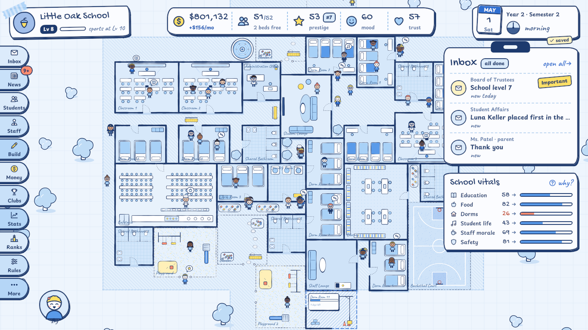
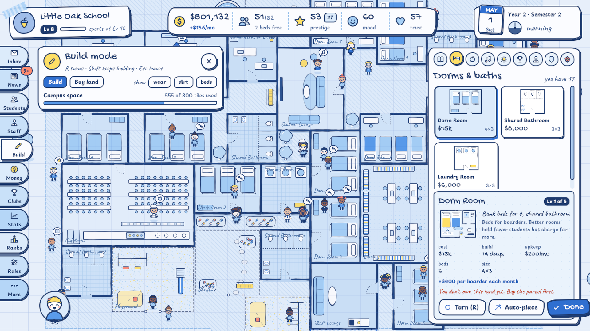
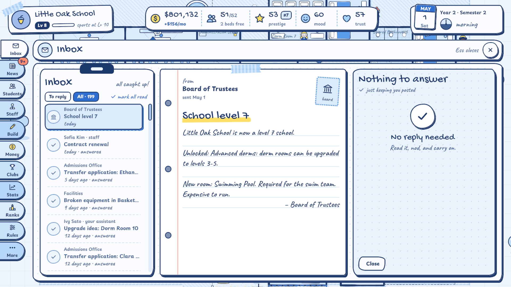
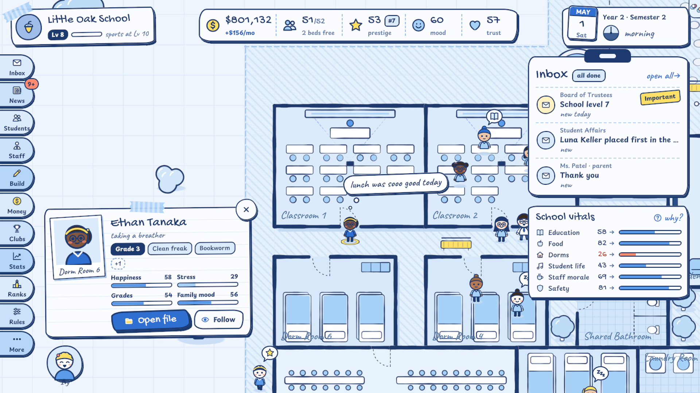

# Back To School Inc.

**A boarding-school management sim made in Unity 6 by McHunter Studio.** You start with a tiny, struggling school and turn it into a prestigious institution:
- build dorms, classrooms and sports grounds on the campus;
- hire staff and answer the inbox;
- keep your promises to parents;
- climb the national rankings.

The whole game looks like blue ballpoint on graph paper, and every line of it is drawn by code.

| | |
|---|---|
|  |  |
|  |  |

---

## Gameplay

- **Time never stops.** One school day passes every 4 seconds, with no pause and no fast-forward. September to June is the school year; July and August are summer and admissions season.
- **Build the campus.** The map is 100×50 tiles, bought parcel by parcel.
  - There are 39 room types with up to 5 levels: dorms, classrooms, a cafeteria, sports grounds, outdoor spaces, decorations, and each specialization's signature building.
  - The walled old estate opens in the late game.
- **Run the school from a notebook.** It has pages for the Inbox, News, Students, Staff, Build, Money, Clubs, Stats, Ranks, Rules, admissions, administration and reports.
- **Everything is connected, and every number explains itself.** Each stat stores the terms that produced it ("Why is Parent Satisfaction 39? −6 Broken promise, +5.1 Value for money…"). A chain plays out on its own, unscripted:
  1. Cheap food makes students unhappy.
  2. Complaints arrive in the inbox, and you promise better food.
  3. You don't deliver, so the broken promise costs trust and prestige.
  4. Fewer families apply.
- **Depth:**
  - 48 kinds of inbox events, promises and inspections;
  - sports seasons and clubs;
  - 8 rival schools and national rankings;
  - admissions with scholarships and students from abroad, plus an endowment;
  - school levels up to 30.
- **An assistant** hired from four candidates (six personality styles, 1–5 stars) spots trouble and brings fixes you can apply straight from the inbox. It also tells the 10-step tutorial.
- **The school's real students and staff** walk around the campus, and you can follow any of them.

**Status:** a complete first version prepared for Steam.
- Release builds, automated playtest and performance checks, a store page draft, store art and a trailer exist.
- Not built yet: paths and corridors, and moving or resizing rooms.

## Tech stack

| Area | What it uses |
|---|---|
| Engine | **Unity 6** (6000.0.32f1), 2D tilemaps |
| Game rules | `SchoolSim.Core`: **pure C# with no UnityEngine references**, a daily tick, one class per system, and every player action as a command |
| Art | A tiny **software rasterizer** (`InkCanvas`): signed-distance shapes with anti-aliasing and a noise "wobble" so lines look hand-drawn. Every tile, room and sprite is generated at runtime and cached, so there are no image assets. |
| UI | **UI Toolkit** notebook HUD (UXML, USS, TSS) with handwriting fonts; an IMGUI debug view in development builds |
| Audio | Music and sound effects written as notes in Python and rendered through **FluidSynth** with the GeneralUser GS soundfont |
| Saving | Three slots; gzip text holding a summary line and the school as JSON, written by a reflection-based serializer on a worker thread, with a backup |
| Testing | **NUnit** tests for the core; a headless **.NET balance harness** with scripted directors; player flags for automated playtests, performance runs, UI tours and UI audits |
| Release | Editor build scripts, a trailer recorder on a fixed clock, and Steam store art made from captures of the release build (Python) |

## What I built

All of it: 131 C# scripts, about 42k lines.

| System | Where |
|---|---|
| The simulation: state, commands, events, saves, tuning, and systems for every area of the school | `Assets/Scripts/Core/` (54 files, ~14k lines): `Simulation.cs`, `Simulation.Commands.cs`, `Systems/`, `Events/`, `Save/`, `Data/` |
| The Unity layer: phases, the clock, bootstrap, settings, audio and save slots | `Assets/Scripts/Game/`: `GameController.cs`, `GameClock.cs`, `Bootstrap.cs`, `GameSettings.cs`, `Audio/`, `Save/` |
| The campus: rasterizer, generated art, room painter, tilemaps, build tools, camera | `Game/Campus/`: `InkCanvas.cs`, `CampusArt.cs`, `RoomPainter.cs`, `CampusView.cs`, `CampusController.cs`, `CampusCamera.cs` |
| Students and staff walking the campus | `Game/People/` |
| The notebook HUD and its pages | `Game/Hud/`, `Assets/UI/Resources/Hud/` |
| Automated checks: playtest, performance, screenshots, key art, trailer, UI tour and audit | `Game/ReleaseChecks*.cs`, `Game/UiTour.cs`, `Game/UiAudit.cs` |
| Editor tools: Windows builds, the app icon, HUD panel settings | `Assets/Scripts/Editor/` |
| Tests and tools | `Assets/Tests/EditMode/`, `Tools/SimHarness/`, `Tools/Music/`, `Tools/Trailer/`, `Tools/StoreArt/` |

The core has one class per system:
- stats, students, relationships, staff, facilities and the economy;
- the inbox and its events, promises, administration and admissions;
- inspections, sports, clubs and rivals;
- progression, the year cycle, the assistant, news, history and the tutorial.

### Code highlights

- **`Core/Simulation.Commands.cs`:** every player action is a command, so the UI never changes state directly. The game, the balance harness and the tests all run the same rules.
- **Explainable stats:** every stat keeps the breakdown that produced it, and the UI shows it under "why?".
- **`FacilitySystem.CheckPlacement`:** placement rules live in the core, shared by the build UI, automatic placement, the harness and the tests.
- **`Game/Campus/InkCanvas.cs` + `CampusArt.cs` + `RoomPainter.cs`:** the art pipeline draws everything at runtime. Furniture follows each room's level and capacity: a level-1 dorm shows three bunk beds for six boarders, while a level-4 dorm has two beds and a private bathroom.
- **`Core/Save/`:** a serializer that keeps shared references. Slots are written on a worker thread through a temp file, keeping the previous save as a backup.
- **`Game/GameClock.cs` + the trailer recorder:** while recording, the game clock steps exactly one frame of game time per captured frame, so the trailer is perfectly smooth. Its cuts land on the beat of its own music.
- **Automated checks in the release build:**
  - `-playtest` drives the real UI with a virtual mouse and keyboard;
  - `-perftest` measures frame times on a grown school;
  - `-uitour` and `-uiaudit` screenshot every screen and state.

## Scenes

| Scene | Purpose |
|---|---|
| `Assets/Scenes/SampleScene.unity` | Any scene works: `Bootstrap` spawns the game when you press Play. |

## Integrated third-party assets

No Asset Store content. The only third-party pieces are:
- **Fonts:** Gochi Hand, Playpen Sans and Caveat, from Google Fonts under the SIL Open Font License. Their license files are in `Assets/UI/Resources/Fonts`.
- **The GeneralUser GS soundfont** by S. Christian Collins, whose license allows use in commercial music. It is used only to render the music offline, so it is not in this repository and the game ships only the rendered audio.

## Docs

- [`PROJECT_README.md`](PROJECT_README.md): the full project notes, covering how it plays, the layout, every system, the campus, the HUD, music and sounds, tuning, and releasing
- `Marketing/Steam/store-page.md`: the Steam store page draft

## About this repository

This public repository is a **showcase**. It contains the documentation and the **160 source files I wrote** for this project. The complete Unity project, with the audio, store-page material and release tooling output, is kept in a private repository.

Copyright © Omer Avcioglu (McHunter Studio). **All rights reserved.** Viewing only; see [LICENSE](LICENSE).
